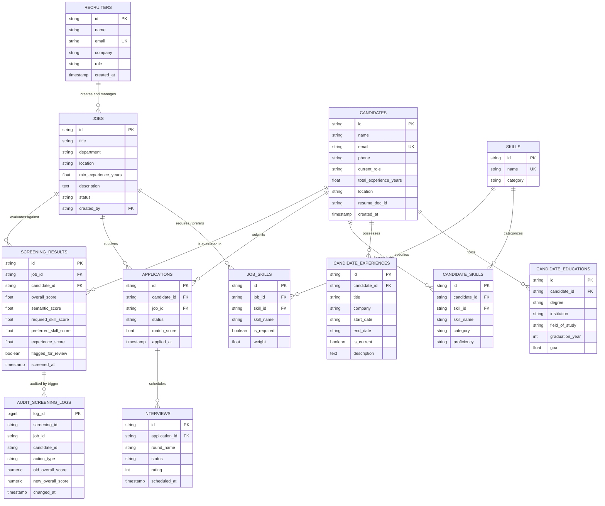

# ResumeIQ: Entity-Relationship & Relational Schema Architecture

This document serves as the formal academic specification of the ResumeIQ database architecture, covering the conceptual Entity-Relationship (ER) model, the logical relational schema, and the physical PostgreSQL 18 data dictionary.

---

## 1. Conceptual Entity-Relationship (ER) Diagram

---

## 2. Relational Schema Diagram (Logical Level)

The database consists of **12 base relational tables** (11 domain tables + 1 audit ledger):

1. **`recruiters`** ($\underline{\text{id}}$, $\text{email}^{\text{UK}}$, $\text{name}$, $\text{company}$, $\text{role}$, $\text{created\_at}$, $\text{updated\_at}$)
2. **`candidates`** ($\underline{\text{id}}$, $\text{email}^{\text{UK}}$, $\text{name}$, $\text{phone}$, $\text{linkedin\_url}$, $\text{github\_url}$, $\text{location}$, $\text{summary}$, $\text{current\_role}$, $\text{total\_experience\_years}$, $\text{resume\_doc\_id}$, $\text{created\_at}$, $\text{updated\_at}$)
3. **`candidate_educations`** ($\underline{\text{id}}$, $\text{candidate\_id}^{\text{FK}}$, $\text{degree}$, $\text{institution}$, $\text{field\_of\_study}$, $\text{graduation\_year}$, $\text{gpa}$, $\text{created\_at}$)
4. **`candidate_experiences`** ($\underline{\text{id}}$, $\text{candidate\_id}^{\text{FK}}$, $\text{title}$, $\text{company}$, $\text{location}$, $\text{start\_date}$, $\text{end\_date}$, $\text{is\_current}$, $\text{description}$, $\text{created\_at}$)
5. **`skills`** ($\underline{\text{id}}$, $\text{name}^{\text{UK}}$, $\text{category}$, $\text{created\_at}$)
6. **`candidate_skills`** ($\underline{\text{id}}$, $\text{candidate\_id}^{\text{FK}}$, $\text{skill\_id}^{\text{FK}}$, $\text{skill\_name}$, $\text{category}$, $\text{proficiency}$, $\text{years\_experience}$)
   - *Composite Unique:* $(\text{candidate\_id}, \text{skill\_name})$
7. **`jobs`** ($\underline{\text{id}}$, $\text{title}$, $\text{department}$, $\text{location}$, $\text{employment\_type}$, $\text{min\_experience\_years}$, $\text{description}$, $\text{required\_skills\_json}$, $\text{preferred\_skills\_json}$, $\text{status}$, $\text{created\_by}^{\text{FK}}$, $\text{created\_at}$, $\text{updated\_at}$)
8. **`job_skills`** ($\underline{\text{id}}$, $\text{job\_id}^{\text{FK}}$, $\text{skill\_id}^{\text{FK}}$, $\text{skill\_name}$, $\text{category}$, $\text{is\_required}$, $\text{weight}$)
   - *Composite Unique:* $(\text{job\_id}, \text{skill\_name})$
9. **`applications`** ($\underline{\text{id}}$, $\text{candidate\_id}^{\text{FK}}$, $\text{job\_id}^{\text{FK}}$, $\text{applied\_at}$, $\text{status}$, $\text{match\_score}$)
   - *Composite Unique:* $(\text{candidate\_id}, \text{job\_id})$
10. **`screening_results`** ($\underline{\text{id}}$, $\text{job\_id}^{\text{FK}}$, $\text{candidate\_id}^{\text{FK}}$, $\text{overall\_score}$, $\text{semantic\_score}$, $\text{required\_skill\_score}$, $\text{preferred\_skill\_score}$, $\text{experience\_score}$, $\text{matched\_skills\_json}$, $\text{missing\_required\_skills\_json}$, $\text{preferred\_skills\_matched\_json}$, $\text{missing\_preferred\_skills\_json}$, $\text{evidence\_snippets\_json}$, $\text{explanation}$, $\text{flagged\_for\_review}$, $\text{flag\_reason}$, $\text{screened\_at}$)
    - *Composite Unique:* $(\text{job\_id}, \text{candidate\_id})$
11. **`interviews`** ($\underline{\text{id}}$, $\text{application\_id}^{\text{FK}}$, $\text{round\_name}$, $\text{scheduled\_at}$, $\text{status}$, $\text{interviewer\_name}$, $\text{feedback}$, $\text{rating}$, $\text{created\_at}$)
12. **`audit_screening_logs`** ($\underline{\text{log\_id}}$, $\text{screening\_id}$, $\text{job\_id}$, $\text{candidate\_id}$, $\text{action\_type}$, $\text{old\_overall\_score}$, $\text{new\_overall\_score}$, $\text{old\_flagged}$, $\text{new\_flagged}$, $\text{changed\_by}$, $\text{changed\_at}$)

---

## 3. Data Dictionary

### Table: `candidates`
| Column | Type | Nullable | Default | Constraints | Description |
|---|---|---|---|---|---|
| `id` | VARCHAR(64) | NO | - | PRIMARY KEY | Unique candidate ID |
| `name` | VARCHAR(255) | NO | - | - | Candidate full name |
| `email` | VARCHAR(255) | YES | - | UNIQUE | Contact email address |
| `phone` | VARCHAR(50) | YES | - | - | Extracted phone number |
| `current_role` | VARCHAR(255) | YES | - | - | Stated current job designation |
| `total_experience_years` | DOUBLE PRECISION | YES | 0.0 | - | Extracted years of total experience |
| `resume_doc_id` | VARCHAR(64) | YES | - | - | FK pointer to document store document |

### Table: `screening_results`
| Column | Type | Nullable | Default | Constraints | Description |
|---|---|---|---|---|---|
| `id` | VARCHAR(64) | NO | - | PRIMARY KEY | Screening result identifier |
| `job_id` | VARCHAR(64) | NO | - | FK -> `jobs(id)` ON DELETE CASCADE | Evaluated job |
| `candidate_id` | VARCHAR(64) | NO | - | FK -> `candidates(id)` ON DELETE CASCADE | Evaluated candidate |
| `overall_score` | DOUBLE PRECISION | NO | - | CHECK ($0 \le x \le 100$) | Final weighted compatibility score |
| `semantic_score` | DOUBLE PRECISION | NO | - | CHECK ($0 \le x \le 100$) | Sentence-BERT cosine similarity score |
| `required_skill_score` | DOUBLE PRECISION | NO | - | CHECK ($0 \le x \le 100$) | Hard-requirement coverage score |
| `preferred_skill_score` | DOUBLE PRECISION | NO | - | CHECK ($0 \le x \le 100$) | Nice-to-have skill match score |
| `experience_score` | DOUBLE PRECISION | NO | - | CHECK ($0 \le x \le 100$) | Experience alignment score |
| `flagged_for_review` | BOOLEAN | YES | FALSE | - | Flag indicating human review is required |
| `flag_reason` | TEXT | YES | - | - | Explanation for review flag |
| `screened_at` | TIMESTAMP | YES | CURRENT_TIMESTAMP | - | Evaluation timestamp |
